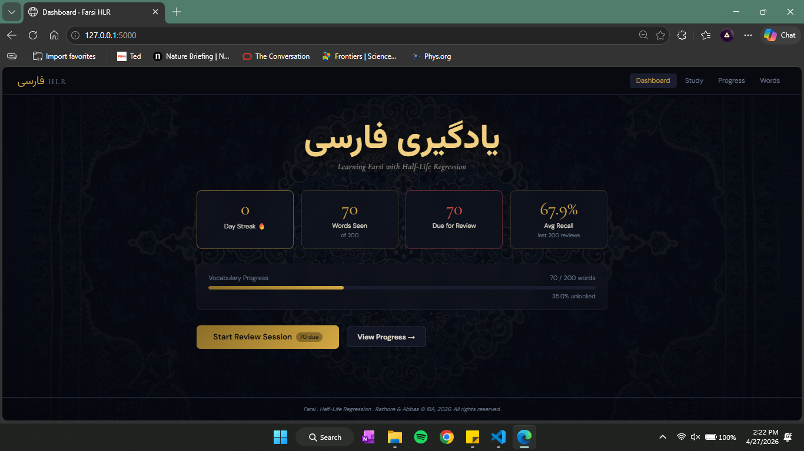
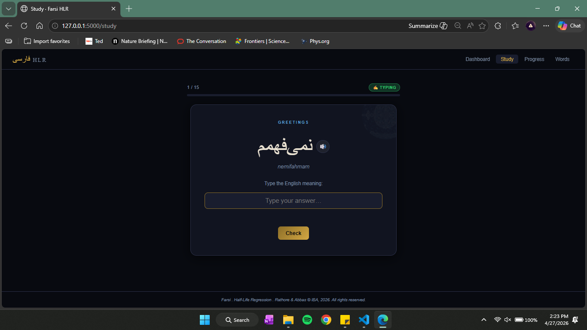
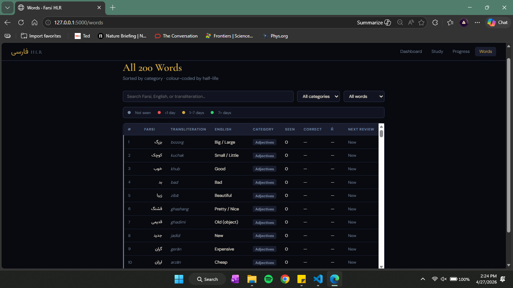
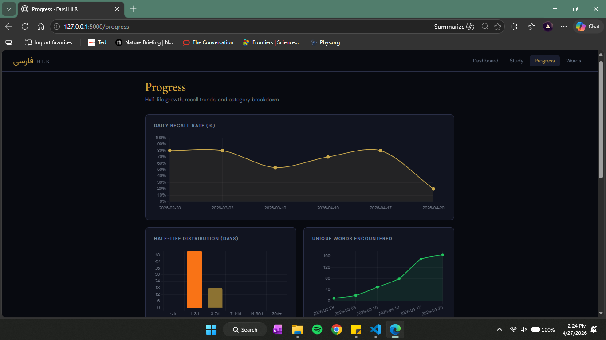
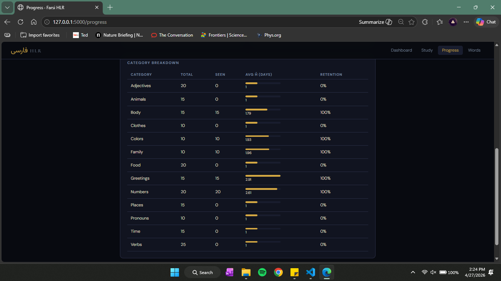

# یادگیری فارسی — Farsi HLR

> A spaced-repetition vocabulary learning system powered by **Half-Life Regression (HLR)**
> *Settles & Meeder, ACL 2016*

**Sudheer Rathore** · ERP 31683 &nbsp;|&nbsp; **Anser Abbas** · ERP 31675
Institute of Business Administration (IBA), Karachi · 2026

---

## What is this?

Farsi HLR teaches a **200-word Farsi (Persian) vocabulary** using a machine-learning-driven spaced repetition algorithm. Instead of fixed flashcard intervals, the system estimates the *half-life* of each word in your long-term memory and schedules its next review at the moment your predicted recall probability drops to 50%.

It runs locally as a small Flask web app, so there is no account, no cloud and no setup beyond Python.

<p align="center">
  
  <br/><sub><b>Dashboard</b>: Persian rug background, streak, words seen, words due and average recall at a glance</sub>
</p>

The dashboard is deliberately simple: four numbers, one progress bar and one main button. When words are due, the button takes you straight into a review session.

---

## Learning: three question modes

Every study session mixes three ways of being tested, so you practise recognising a word, recalling it and producing it.

| Mode | Icon | What you do |
|---|---|---|
| Multiple Choice | ⚡ MCQ | Pick the correct English meaning from four options |
| Flashcard | 🃏 Flashcard | Reveal the answer, then mark yourself correct or incorrect |
| Free Typing | ✍️ Typing | Type the English meaning from memory |

A session draws from an equal-thirds pool of all three types. Word order and question types are shuffled independently with Fisher-Yates, so no two sessions look the same. Every card also has a 🔊 button that pronounces the Farsi word using the browser's built-in `fa-IR` voice.

<p align="center">
  
  <br/><sub><b>Study session</b>: typing mode, with the Farsi word, its transliteration and the pronunciation button</sub>
</p>

---

## The algorithm: Half-Life Regression

Based on **Settles & Meeder (ACL 2016)**, HLR combines Ebbinghaus's forgetting curve with machine learning:

```
p = 2^(−Δ/h)          Forgetting curve: recall probability after lag Δ
ĥ = 2^(Θ·x)           Estimated half-life from the feature vector x
x = [1, √n, √n₊, √n₋] Features: bias, times seen, times correct, times incorrect
```

The weights Θ are trained by minimising the following loss with AdaGrad:

```
ℓ = (p − p̂)² + α(h − ĥ)² + λ‖Θ‖²
```

The global weight vector Θ is stored in SQLite and updated after **every review event**, so the model adapts to how you personally forget.

| Hyperparameter | Value | Role |
|---|---|---|
| λ (L2 regularisation) | 0.1 | Prevents overfitting |
| α (half-life loss weight) | 0.01 | Balances the recall and half-life terms |
| η (AdaGrad learning rate) | 0.001 | Weight update step size |
| ĥ bounds | 15 min to 9 months | Overflow and underflow guard |

---

## Vocabulary: 200 Farsi words

The words are organised into 13 semantic categories, sized to stay within working-memory limits (Nation, 2001).

| Category | Count | Category | Count |
|---|---|---|---|
| Verbs | 25 | Greetings | 15 |
| Adjectives | 20 | Body | 15 |
| Numbers | 20 | Time | 15 |
| Food & Drink | 20 | Places | 15 |
| Animals | 15 | Family | 10 |
| Colors | 10 | Pronouns | 10 |
| Clothes | 10 | **Total** | **200** |

The **Words** page lists every word with its transliteration, English meaning, category, accuracy and current half-life. You can search by Farsi, English or transliteration, and filter by category or by seen and unseen. Each row is colour-coded by half-life: grey for not seen, red for under 1 day, gold for 1 to 7 days and green for 7 days or more.

<p align="center">
  
  <br/><sub><b>Word list</b>: all 200 words with search, filters and half-life colour bands</sub>
</p>

---

## Analytics

The **Progress** page shows how well the learning is sticking.

- **Daily Recall Rate**: average recall per calendar day
- **Half-Life Distribution**: how many words sit in each retention tier, from fragile (under 1 day) to strong (30+ days)
- **Unique Words Encountered**: cumulative vocabulary growth

<p align="center">
  
  <br/><sub><b>Progress charts</b>: recall trend, half-life distribution and vocabulary growth</sub>
</p>

Below the charts, the **Category Breakdown** table shows, for each category, how many words you have seen, the average estimated half-life ĥ (with a proportional bar) and the coverage percentage. It makes it easy to spot which topics are holding up and which need more practice.

<p align="center">
  
  <br/><sub><b>Category breakdown</b>: per-category coverage and average half-life</sub>
</p>

---

## Tech stack

| Layer | Technology |
|---|---|
| Backend | Python 3 · Flask |
| Database | SQLite (Python `sqlite3`) |
| Frontend | Vanilla JS · CSS3 |
| Fonts | Vazirmatn (Farsi) · Cormorant Garamond · DM Sans |
| Charts | Chart.js 4.4 |
| Voice | Web Speech API (`fa-IR`), no extra dependencies |

---

## Quick start

### Requirements
- Python 3.10 or newer
- pip

### Setup

```bash
# 1. Clone the repo
git clone https://github.com/SJRATHORE/Half-Life-Regression-Language-Learning-Model-.git
cd Half-Life-Regression-Language-Learning-Model-

# 2. Create and activate a virtual environment
python3 -m venv venv

# Linux / macOS
source venv/bin/activate

# Windows
venv\Scripts\activate

# 3. Install dependencies
pip install flask

# 4. Run the app (the database is created and seeded on first launch)
python app.py
```

Then open **http://localhost:5000** in your browser.

On Windows you can also double-click `start.bat`, which activates the virtual environment and starts the server.

---

## Project structure

```
farsi-hlr/
│
├── app.py              # Flask routes
├── hlr.py              # HLR model: forgetting curve, AdaGrad, scheduling
├── database.py         # SQLite schema and query helpers
├── seed_words.py       # 200 Farsi words (seeded on first launch)
├── requirements.txt
├── start.bat           # Windows launcher
│
├── data/               # SQLite database lives here (git-ignored)
│
├── static/
│   ├── css/style.css
│   ├── js/study.js     # Flashcard / MCQ / Typing logic and pronunciation
│   ├── js/progress.js  # Chart.js analytics
│   └── images/         # Persian rug background
│
├── templates/
│   ├── base.html
│   ├── dashboard.html
│   ├── study.html
│   ├── results.html
│   ├── progress.html
│   └── word_list.html
│
└── docs/
    ├── AI.pdf          # Project report
    └── screenshots/    # UI screenshots
```

---

## Developer tools

Press the **backtick key** (`` ` ``) on the dashboard or any study page to open the dev toolbar:

- **Force mode**: lock every question to MCQ, Flashcard or Typing for isolated testing
- **Time warp**: shift all timestamps back by 1 day, 3 days, 1 week or 30 days to simulate future sessions and check HLR scheduling and the progress graphs

---

## Report

The full project report is at [`docs/AI.pdf`](docs/AI.pdf). It covers the choice of language, UI design rationale, word grouping, the HLR derivation, analytics design and proposed improvements.

---

## References

- Settles, B. & Meeder, B. (2016). *A Trainable Spaced Repetition Model for Language Learning.* ACL 2016, Berlin.
- Ebbinghaus, H. (1885). *Memory: A Contribution to Experimental Psychology.*
- Duchi, J., Hazan, E. & Singer, Y. (2011). Adaptive subgradient methods for online learning and stochastic optimization. *JMLR*, 12.
- Nation, I.S.P. (2001). *Learning Vocabulary in Another Language.* Cambridge University Press.
- Sweller, J. (1988). Cognitive load during problem solving. *Cognitive Science*, 12(2).

---

## About

Course project by Sudheer Rathore and Anser Abbas, IBA Karachi, 2026.
